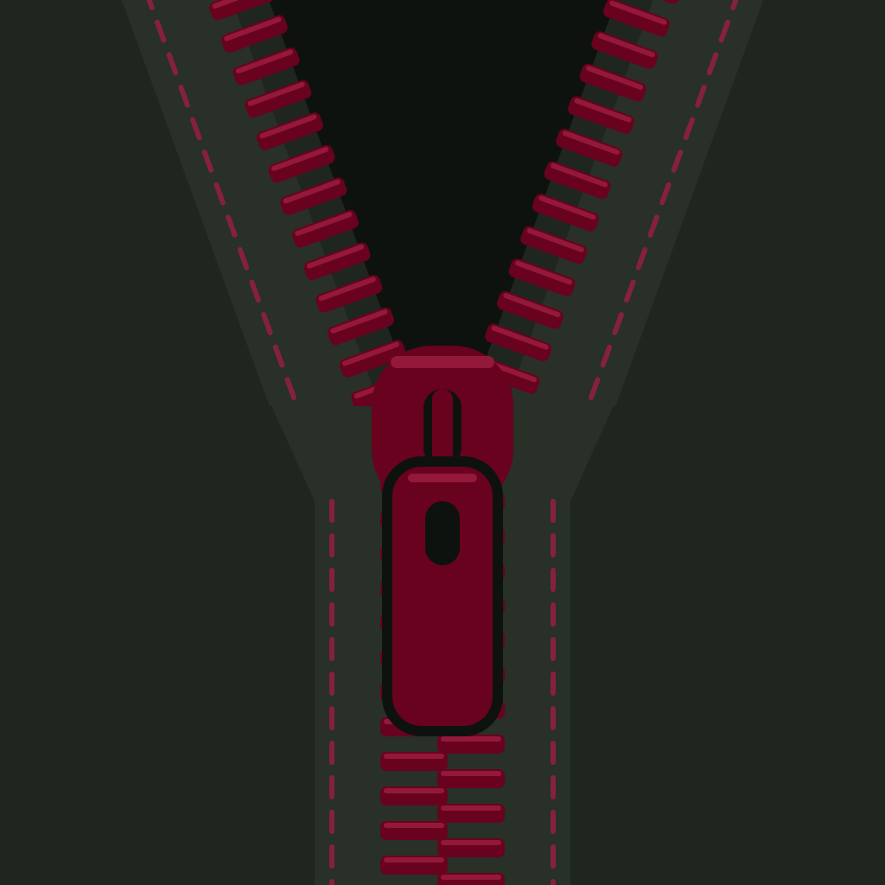
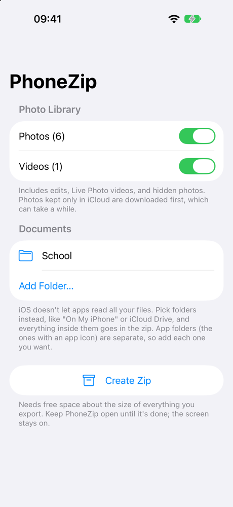
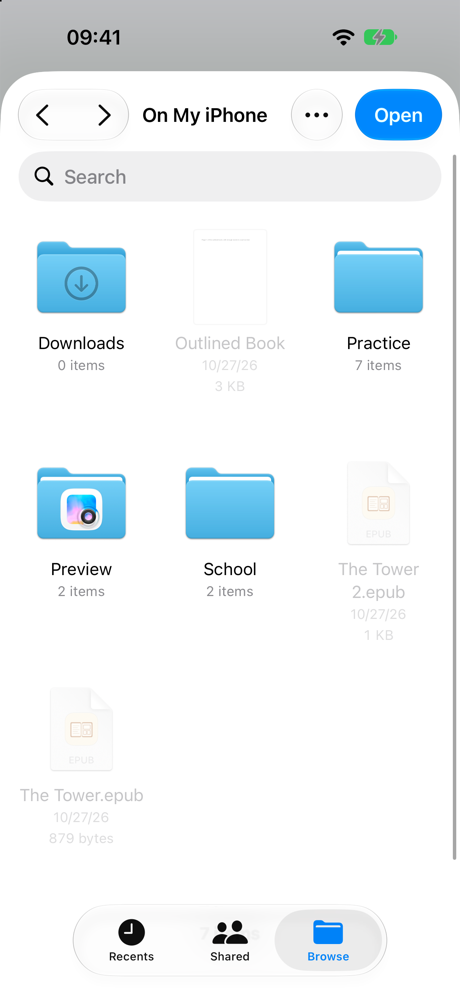
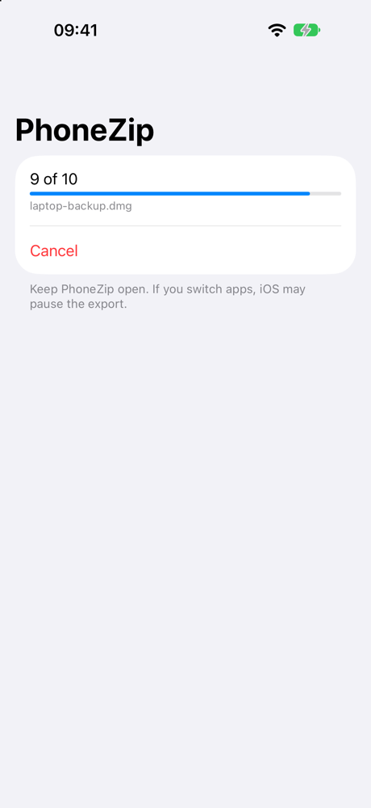
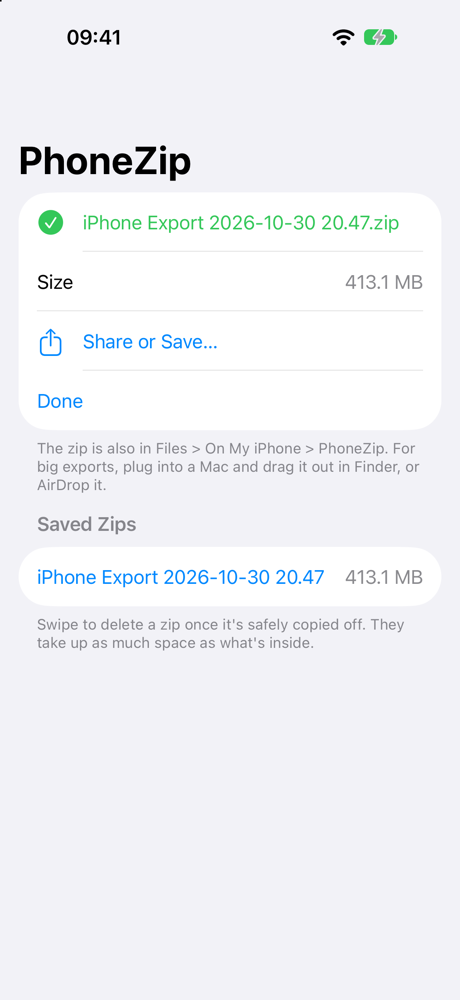

# PhoneZip

An iPhone app that copies your photos, videos and documents into one zip
file, unzips it onto a USB drive, checks every file, and then (if you say
so) deletes the originals from the phone.

## Why it exists

The goal is a full copy of the phone on a NAS. iOS has no built-in way to
export the whole photo library plus documents as plain files, and copying
thousands of photos one by one is slow and easy to get wrong. PhoneZip turns
everything into a single file, which is easy to move to a USB drive and from
there to the NAS.

Nothing is uploaded anywhere. The app has no account, no network code and no
tracking; the zip stays on the phone until you move it.

## Screenshots

From the iPhone 18 Pro simulator: choosing what to export, adding a folder
from Files, the export running, and the finished zip.

<p>
  
  
  
  
</p>

## What goes in the zip

```
iPhone Export 2026-10-30 20.17.zip
├── Photos/
│   ├── 2024/2024-05/IMG_0001.HEIC
│   ├── 2024/2024-05/IMG_0001.MOV      ← the Live Photo video, same name
│   ├── 2024/2024-06/IMG_0042.JPG      ← an edited photo, as it looks in Photos
│   ├── 2024/2024-06/IMG_0042 (original).HEIC   ← and its untouched original
│   └── Undated/...
├── Files/
│   ├── On My iPhone/...               ← each picked folder, subfolders kept
│   └── Taxes/...
└── Skipped files.txt                  ← only if something couldn't be read
```

- **Photos and videos:** the whole library, oldest first, filed by the month
  they were taken. Edited photos and videos are exported as you see them in
  Photos, plus their untouched original (`… (original).HEIC`), so nothing is
  lost if the phone's copy is deleted later. Live Photos include their video,
  RAW+JPEG pairs include the RAW, and hidden photos are included. Photos kept only in iCloud ("Optimize iPhone Storage")
  are downloaded during the export.
- **Documents:** iOS never lets an app read every file on the phone. Instead
  you pick folders in the Files picker (On My iPhone, iCloud Drive, ...) and
  everything inside them goes in. App folders under On My iPhone (the ones with
  an app icon) are separate locations and have to be picked one by one.
- **Skipped files:** anything that couldn't be read (an iCloud download that
  failed, say) is listed in `Skipped files.txt` inside the zip, so missing
  files don't go unnoticed.

## Using it

1. Open PhoneZip and tap **Allow Photo Access**, then **Allow Full Access**.
   With "Limited Access" only the photos you selected are exported.
2. Turn Photos / Videos on or off, and tap **Add Folder…** for any documents.
3. Tap **Create Zip**. Keep the app open and the phone plugged in; the screen
   stays on while it works, and **Cancel** stops it and deletes the partial zip.
4. When it's done, plug in your USB drive and tap **Move to Drive…**. Choose
   the drive (or a folder on it) under Locations. PhoneZip remembers it, so
   next time the button reads **Move to *drive name*** as soon as it's
   plugged in.
5. PhoneZip unzips everything into a folder named after the export
   (`iPhone Export 2026-10-30 20.17/`) and reads every file back from the
   drive to check it. If all files match, the zip on the phone is removed.
6. You see what was copied and checked. Tap **Delete Originals from
   iPhone…** to free up the phone, or **Keep Them**. PhoneZip shows exactly
   what will be deleted and asks first; iOS then asks again before deleting
   photos.

You can also skip the drive: the zip stays in **Files › On My iPhone ›
PhoneZip** (and under Saved Zips, with a Share button) to move another way.

### What deleting does

- Only originals whose copy on the drive was read back and matched are
  deleted. A photo is deleted only if *all* its files (edit, original, Live
  Photo video, RAW) matched. Anything that failed stays on the phone, along
  with the zip.
- Photos go to **Photos › Recently Deleted** for 30 days. The space comes back
  only after that's emptied, and until then they can be recovered.
- Documents go to Files' **Recently Deleted** where the location has one.
- **If iCloud Photos is on, deleting from the phone also deletes from iCloud
  and every other device.** The same goes for files picked from iCloud Drive.
- Albums, favorites, captions and people tags aren't part of the copy.
- A folder on the phone itself can't be chosen as the "drive": deleting the
  originals after copying to the same phone would leave no copy anywhere else.

### The USB drive

- Format the drive as **exFAT**. FAT32 can't hold files over 4 GB. Most NAS
  USB ports read exFAT (on Synology it may need enabling in Package Center),
  so the drive can then go straight into the NAS.
- It needs free space for everything in the export; PhoneZip checks before
  starting and stops without deleting anything if it's too small.
- Thumb drives and portable SSDs run on the phone's power; an older spinning
  hard drive may need a powered hub.
- Speed depends on the phone: USB-C Pro models copy at USB 3 speed with a
  USB 3 cable; other iPhones manage roughly 30–40 MB/s. Every file is also
  read back to check it, so expect roughly twice the plain copy time.

### Limits

- **Free space:** the zip is built on the phone, so it needs free space about
  the size of everything being exported. The export stops with a message when
  less than 500 MB would be left.
- **Stay in the app:** iOS pauses apps that leave the screen, which pauses the
  export and the copy to the drive.
- **The finished step doesn't survive closing the app:** Move to Drive and
  Delete Originals are offered right after an export. If PhoneZip is closed in
  between, the zip is still in Saved Zips, but deleting originals needs a new
  export.
- **Not encrypted:** the zip and the drive copy are full, readable copies of
  your photos and files. Keep the drive somewhere safe.

## How it works

The export runs in the background, one item at a time
([`Exporter.swift`](PhoneZip/Exporter.swift)):

1. **List everything first.** [`PhotoSource`](PhoneZip/PhotoSource.swift) asks
   PhotoKit for every photo and video and picks which stored files of each to
   export (edited version or original, plus the Live Photo video).
   [`FolderSource`](PhoneZip/FolderSource.swift) walks each picked folder,
   skipping hidden files and PhoneZip's own folder (otherwise an export could
   end up zipping itself). [`ZipPathAllocator`](PhoneZip/ExportItem.swift)
   gives every file a unique path in the zip, so two `IMG_0001.HEIC` from the
   same month become `IMG_0001.HEIC` and `IMG_0001 (2).HEIC`.
2. **Add files one by one.** Each photo is copied to a temporary file, added to
   the zip, and the temporary file deleted, so extra space never goes beyond the
   zip plus one photo. Documents are read through a file coordinator, which
   makes iCloud Drive download files that are only placeholders.
3. **Write the zip with [ZIPFoundation](https://github.com/weichsel/ZIPFoundation).**
   Photos and videos are *stored* (already compressed, so compressing them again
   costs minutes and saves almost nothing); documents are *deflated*. The zip
   uses ZIP64 when needed, so archives over 4 GB open on Mac, Windows and NAS.
   File names are normalized so accented names (like "Café") show correctly on
   Windows.
4. **Check space before every file**, and on failure or cancel delete the
   half-written zip. A new export never overwrites an earlier one: two exports
   in the same minute become `… 20.17.zip` and `… 20.17 (2).zip`. While
   building, it records where every file in the zip came from (which photo,
   which document); only that record decides what can be deleted later.
5. **Copy to the drive** ([`DriveTransfer.swift`](PhoneZip/DriveTransfer.swift)).
   Entries are unzipped straight from the phone onto the drive (no copy of the
   zip on the drive, which would need double the space). Each file is flushed
   to the drive, then read back with the cache bypassed and compared with the
   CRC-32 checksum and size stored in the zip. Entry paths that would escape
   the export folder are refused. If the copy is cancelled or the drive fills
   up, the half-finished folder is removed.
6. **Delete originals.** Photos are deleted through PhotoKit, which shows its
   own confirmation and moves them to Recently Deleted. Documents are moved to
   Files' Recently Deleted, or deleted through a file coordinator where there
   is none, so iCloud Drive stays in step.

The drive is remembered with a bookmark of the folder you picked. iOS gives
apps no list of attached drives; the Files picker is the only way in, and the
bookmark keeps that permission for next time.

## Building and running

Requirements: a Mac with Xcode (built with Xcode 27) and
[XcodeGen](https://github.com/yonaskolb/XcodeGen) (`brew install xcodegen`).
The app targets iOS 17 and later.

The Xcode project isn't in git; it is generated from `project.yml`:

```bash
cd ~/Developer/PhoneZip
```

```bash
xcodegen generate
```

```bash
open PhoneZip.xcodeproj
```

Then in Xcode pick your iPhone (or a simulator) at the top and press Run (⌘R).
Signing uses the development team set in `project.yml`; change
`DEVELOPMENT_TEAM` there (and run `xcodegen generate` again) to sign with a
different account. The first time, the iPhone may ask you to trust the
developer under **Settings › General › VPN & Device Management**, and needs
Developer Mode on.

Run `xcodegen generate` again after adding, moving or deleting source files.

Build from the command line for the simulator (the output lands in
`DerivedData/Build/Products/Debug-iphonesimulator/PhoneZip.app`, which git
ignores):

```bash
xcodebuild -project PhoneZip.xcodeproj -scheme PhoneZip -destination 'platform=iOS Simulator,name=iPhone 18 Pro' -derivedDataPath DerivedData build
```

### App icon

The icon is drawn in code by [`Tools/make-icon.swift`](Tools/make-icon.swift).
To change it, edit the colors or shapes there and redraw it from the repo root:

```bash
swift Tools/make-icon.swift
```

If the phone keeps showing the old icon after a reinstall, delete the app and
run it again (this deletes zips still stored inside PhoneZip, so move them off
first).

## Project layout

| Path | What it does |
| --- | --- |
| `PhoneZip/ContentView.swift` | The single screen: photo access, folder list, progress, finished zip, saved zips |
| `PhoneZip/Exporter.swift` | Runs each step: the export, the copy to the drive, the clean-up |
| `PhoneZip/DriveTransfer.swift` | Unzips onto the drive, checks every file, deletes checked originals |
| `PhoneZip/PhotoSource.swift` | Reads the photo library through PhotoKit |
| `PhoneZip/FolderSource.swift` | Reads folders picked in Files |
| `PhoneZip/ExportItem.swift` | One item to export, and unique paths inside the zip |
| `Tools/make-icon.swift` | Draws the app icon |
| `docs/screenshots/` | Simulator screenshots used in this README |
| `project.yml` | XcodeGen project definition (settings, signing, ZIPFoundation version) |
